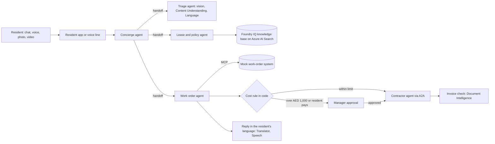

# Architecture

This page shows the target design for v1.0. What is built so far is listed in the README under "What it does now"; each release updates both.

## Context

| Actor | Uses the product to |
|---|---|
| Resident | Report a problem by chat, voice note, call, photo or video, in Arabic or English, and get updates |
| Community manager | Review triage, approve costs above the limit, see the audit trail |
| Contractor | Receive work orders, send quotes and invoices |
| Leasing and marketing | Create listing images and teaser videos with AI disclosure |

## Request flow (v1.0)

Across every step: guardrails and prompt shields, PII redaction before logging, traces, and evaluations.

## Components by layer

| Layer | Components |
|---|---|
| Intelligence | Main chat model, small triage model, embedding model, image and video models, speech models |
| Data / Knowledge | Leases, community rules, maintenance SLA, appliance manuals, contractor rate card, residents and units |
| Context / Retrieval | Azure AI Search index (hybrid plus semantic ranking), Foundry IQ knowledge base |
| Memory / State | Conversation state, work-order state, workflow state and approvals |
| Orchestration / Action | Foundry agents, the maintenance workflow, Agent Framework orchestration, tools, MCP server, A2A contractor agent |
| Integration / Experience | Resident app, staff console, listing studio, voice line, work-order API |
| Evaluation / Reliability | Evaluation sets, evaluators, red-team set, CI evaluations, traces, retries |
| Security / Controls | Keyless sign-in and roles, guardrails, prompt shields, PII redaction, approval gates, tool permissions, AI disclosure |
| Infrastructure / Operations | Foundry project and deployments, quotas, budget alert, Application Insights, GitHub Actions |

## Trust boundaries

- **Spending authority** sits in the workflow's approval gate and in tool permissions, never in a prompt. Agents can propose; only an approved workflow step can commit spend.
- **Text inside documents and images is data**, not instructions. Retrieved or extracted text never changes an agent's instructions or permissions.
- **Personal data** is redacted before anything is logged or stored.
- **Generated media** carries an AI disclosure before it can be published.

## Decisions

Architecture decision records live in [adr/](adr/). The template is `ADR-000-template.md`.
